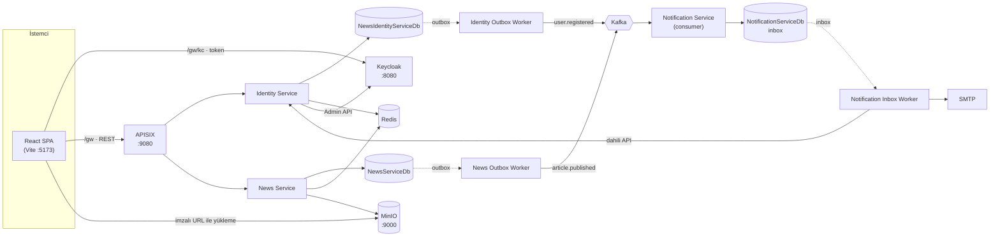
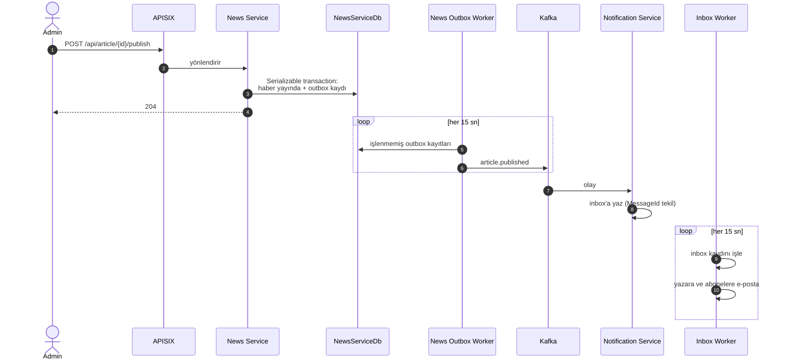

# Telgraf — Mikroservis Haber Portalı

Telgraf; haber yayınlama, kullanıcı ve yetki yönetimi ile e-posta bildirimlerini birbirinden bağımsız servislerde çalıştıran bir haber portalıdır. Servisler arası iletişim **Kafka** üzerinden, olaylar **Transactional Outbox / Inbox** desenleriyle taşınır. Kimlik doğrulama **Keycloak**, trafik yönetimi **Apache APISIX**, gözlemlenebilirlik ise **ELK + Elastic APM + Grafana** ile yapılır.


---

## İçindekiler

- [Özellikler](#özellikler)
- [Mimari](#mimari)
- [Tasarım kararları](#tasarım-kararları)
- [Teknoloji yığını](#teknoloji-yığını)
- [Kurulum](#kurulum)
- [Adresler](#adresler)
- [API özeti](#api-özeti)
- [Proje yapısı](#proje-yapısı)
- [Geliştirme](#geliştirme)
- [Bilinen sınırlamalar ve yol haritası](#bilinen-sınırlamalar-ve-yol-haritası)

---

## Özellikler

Uygulamada üç yetki seviyesi vardır: **Okuyucu**, **Editör** ve **Admin**. Her kullanıcının tek bir yetkisi olur. Admin, editörün yapabildiği her şeyi de yapabilir.

### Okuyucu
- Yayındaki haberlerden oluşan akış, kategori filtresi ve sayfalama
- Türkçe büyük/küçük harf duyarsız arama (`SÜPER LİG` ile `süper lig` aynı sonucu verir)
- Haber detay sayfası
- Üst barda Ankara hava durumu (Open-Meteo) ve piyasa şeridi: BIST 100, Dolar, Euro, Gram altın (Yahoo Finance)
- Hesap sayfası ve bülten aboneliğini açıp kapatma
- Kayıt, e-posta doğrulama ve şifre sıfırlama (Keycloak)

### Editör
- Haber taslağı oluşturma ve kendi taslaklarını düzenleme
- Kapak görseli yükleme: dosya tarayıcıdan doğrudan depoya gider, sunucu 400, 800 ve 1200 px genişliğinde WebP kopyalarını üretir ve sayfa `srcset` ile ekrana uygun boyutu seçer
- Etiket seçimi ve "abonelere bildir" seçeneği

### Admin
- Haber yayınlama ve silme, her haberi düzenleme
- Kategori ve etiket yönetimi (adlar büyük/küçük harf duyarsız benzersizdir)
- Kullanıcıların yetkisini değiştirme (Okuyucu / Editör / Admin) ve hesabı pasife alma veya yeniden açma
- Koruma kuralları: admin kendi hesabını pasife alamaz; son aktif adminin yetkisi düşürülemez ve hesabı pasife alınamaz

### Bildirimler
| Olay | E-posta |
|---|---|
| Kullanıcı kaydoldu | Hoş geldin e-postası |
| Haber yayınlandı | Yazara "haberiniz yayında" bildirimi |
| Haber "abonelere bildir" seçilerek yayınlandı | Bülten abonelerine duyuru |

---

## Mimari



### Servisler

| Servis | Görevi |
|---|---|
| **identity-service** | Kayıt, profil, kullanıcı yönetimi, yetkiler. Keycloak ile yerel veritabanını birlikte günceller. Token iptal kayıtlarını Redis'e yazar. |
| **news-service** | Haber, kategori, etiket, medya, hava durumu ve piyasa uç noktaları. Haber listelerini Redis'te önbelleğe alır. |
| **notification-service** | Kafka'yı dinler ve gelen olayları inbox tablosuna yazar. Dışarıya açık uç noktası yoktur. |
| **identity-outbox-worker** | Identity outbox tablosundaki olayları Kafka'ya yayınlar. |
| **news-outbox-worker** | News outbox tablosundaki olayları Kafka'ya yayınlar. |
| **notification-inbox-worker** | Inbox'taki olayları işler ve e-postaları gönderir. |
| **healthcheck-api** | Tüm süreçlerin sağlığını tek panelde toplar ve sorun olunca Slack/Discord'a bildirim gönderir. |

Servisler dışarıya port açmaz; tüm REST trafiği APISIX (`:9080`) üzerinden geçer. Giriş istekleri ise doğrudan Keycloak'a gider.

### Bir haberin yayınlanması



Aynı haberi iki admin aynı anda yayınlarsa yalnızca biri başarılı olur, diğeri `409` alır ve yalnızca tek bir olay üretilir.

---

## Tasarım kararları

### Katmanlı servis yapısı
Her servis Clean Architecture ile dört projeye ayrılır: **Domain**, **Application**, **Persistance** ve **WebApi**. İş mantığı MediatR handler'larında durur. Doğrulama FluentValidation ile yapılır ve hata mesajları Türkçedir. Bir pipeline behavior her komutu süresi ve hedefiyle birlikte loglar. `Shared` projesi yalnızca servis sınırını geçen sözleşmeleri taşır: olaylar, topic adları ve hata kodları.

### Güvenilir mesajlaşma
- **Transactional Outbox:** İş verisi ve olay aynı transaction'da yazılır, sonra ayrı bir worker Kafka'ya taşır. Bu sayede veritabanına yazılıp Kafka'ya gitmeyen olay kalmaz.
- **Inbox:** `MessageId` üzerinde tekil indeks vardır. Aynı olay iki kez gelse de bir kez işlenir.
- **Yeniden deneme:** Başarısız mesajlar yeniden denenir; deneme sınırı aşılınca dead-letter olarak işaretlenir ve sağlık panelinde görünür.

### Eşzamanlılık
Yayınlama, yetki değiştirme ve pasife alma işlemleri `Serializable` transaction içinde çalışır. PostgreSQL'in serileştirme çakışmaları (`40001`, `40P01`) kullanıcıya `409 CONCURRENCY_CONFLICT` ve Türkçe bir açıklama olarak döner.

### Keycloak ile yerel veritabanını uyumlu tutmak
Kullanıcı rolleri ve aktiflik durumu hem Keycloak'ta hem yerel veritabanında tutulur. Önce Keycloak güncellenir, ardından veritabanı. Veritabanı adımı başarısız olursa Keycloak'taki değişiklik geri alınır (telafi işlemi).

### Token iptali
Access token 1 saat geçerlidir ve refresh token kullanılmaz; süre dolunca kullanıcı yeniden giriş yapar.

Yetkisi değişen ya da pasife alınan kullanıcının elindeki token hemen geçersiz olmalıdır. Bunun için Redis'e `identity:revoked:{keycloakId}` kaydı yazılır (2 saat ömürlü). Her istekte `TokenRevocationMiddleware` token'ın üretilme zamanını (`iat`) bu kayıtla karşılaştırır:

| Durum | Yanıt |
|---|---|
| Hesap pasife alınmış | `403 AUTH_ACCOUNT_DISABLED` |
| Yetkiler değişmiş | `401 AUTH_TOKEN_STALE` |

Redis'e ulaşılamazsa istek geçirilir. Böylece Redis kesintisi sistemi durdurmaz; iptal edilen token en fazla kendi süresi (1 saat) dolana kadar geçerli kalır. Pasife alınan kullanıcı ise Keycloak hesabı kapalı olduğu için zaten yeni token alamaz.

### Gateway ve kötüye kullanım koruması
APISIX, IP başına istek sınırı uygular. Sınır aşıldığında uygulamanın hata biçiminde `429` ve `Retry-After` başlığı döner.

| Uç nokta | Sınır |
|---|---|
| `/api/auth/register` | 10 dakikada 5 |
| `/api/media/upload-url` | Dakikada 20 |
| `/api/auth`, `/api/media` | Dakikada 60 |
| Diğer `/api/*` uçları | Dakikada 300 |

Servisler arası `/api/user/internal/*` uçları gateway'de dışarıya kapalıdır. Giriş denemelerine karşı koruma Keycloak'ın brute-force ayarıyla hesap bazında yapılır.

### Önbellek
Redis'te haber listeleri, kategoriler, etiketler, hava durumu, piyasa verisi, kullanıcı dizini ve profiller tutulur. Önbellek servisinde devre kesici vardır: Redis yanıt vermezse istekler doğrudan veritabanına gider.

### Hata biçimi
Tüm servisler, gateway'in `429` yanıtları da dahil, aynı gövdeyi döndürür:

```json
{
  "status": 409,
  "errorCode": "CATEGORY_IN_USE",
  "message": "Bu kategori silinemez.",
  "description": "'Bilim' kategorisine bağlı 5 haber var. Silmeden önce bu haberleri başka bir kategoriye taşıyın.",
  "errors": null
}
```

`message` ne olduğunu, `description` ne yapılması gerektiğini söyler. Doğrulama hatalarında `errors` alan bazlı mesajları taşır.

### Gözlemlenebilirlik
- **Loglar:** Serilog, ECS biçimindeki logları Kafka'daki `logs` topic'ine yazar. Logstash bunları Elasticsearch'e taşır (`logs-{servis}-{gün}`) ve Kibana ile Grafana'da incelenir. Loglarda e-posta adresi değil Keycloak ID'si bulunur.
- **İzleme:** Elastic APM ile servisler arası trace'ler Kibana'da loglarla eşleşir.
- **Sağlık kontrolleri:** Her süreçte üç uç vardır: `/health/live`, `/health/ready` ve `/health` (tüm bağımlılıklar). `/health/ready` servislerde yalnızca PostgreSQL'e, worker'larda işlem döngüsünün canlılığına bakar; böylece Redis veya Kafka kesintisi servisi devre dışı bırakmaz. Sağlık paneli (`:9095`) son 5 dakikadaki hata loglarını da sayar; eşik aşılınca veya bir süreç sağlıksızlaşınca webhook bildirimi gönderir.

---

## Teknoloji yığını

| Katman | Teknolojiler |
|---|---|
| Backend | .NET 10, ASP.NET Core, EF Core 10 (Npgsql), MediatR, FluentValidation, Serilog |
| Frontend | React 19, React Router 7, TypeScript, Vite, Oxlint |
| Kimlik | Keycloak 24 (realm `news-portal`) |
| Gateway | Apache APISIX 3.16, etcd, APISIX Dashboard |
| Veri | PostgreSQL 16, Redis 7.2 (AOF açık), MinIO (S3 uyumlu) |
| Mesajlaşma | Apache Kafka 7.6 (Confluent), Zookeeper |
| Görsel işleme | SixLabors.ImageSharp, AWS SDK for S3 |
| Gözlemlenebilirlik | Elasticsearch, Logstash, Kibana, Elastic APM 8.13, Grafana 11, Prometheus, AspNetCore.HealthChecks.UI |

---

## Kurulum

### Gereksinimler
- Docker Desktop (Elastic Stack ve Kafka için Docker'a en az 8 GB bellek ayrılması önerilir)
- Node.js 22+ ve npm
- `jq` (kurulum betikleri için)
- .NET 10 SDK yalnızca servisleri Docker dışında geliştirmek için gerekir

### 1. Ortam değişkenleri

```bash
cp .env.example .env
```

`.env` içinde Elasticsearch ve Kibana parolaları zorunludur; boş kalırsa compose başlamaz. Parolaları rastgele üretebilirsiniz:

```bash
openssl rand -base64 24
```

| Değişken | Açıklama |
|---|---|
| `ELASTIC_PASSWORD`, `KIBANA_PASSWORD`, `LOGSTASH_PASSWORD`, `LOG_READER_PASSWORD` | Elastic Stack hesapları (zorunlu) |
| `KIBANA_ENCRYPTION_KEY` | En az 32 karakter ve sabit kalmalı (`openssl rand -hex 16`) |
| `INTERNAL_API_KEY` | Servisler arası dahili çağrı anahtarı (`openssl rand -hex 32`) |
| `SMTP_USERNAME`, `SMTP_PASSWORD` | E-posta gönderimi için. Gmail'de uygulama parolası gerekir. Boş bırakılırsa e-posta gönderilmez. |
| `HEALTH_WEBHOOK_URL` | Slack/Discord webhook adresi (isteğe bağlı) |
| `PUBLIC_WEB_ORIGIN` | Uygulamanın açıldığı adres; Keycloak ve MinIO CORS ayarları bunu kullanır |

### 2. Elastic Stack güvenliği

```bash
docker compose up -d elasticsearch kibana
```

```bash
./docker/setup-elastic-security.sh
```

### 3. Tüm sistemi başlatma

```bash
docker compose up -d
```

İlk açılışta veritabanı şemaları migration'larla otomatik oluşur ve Keycloak realm'i içe aktarılır.

### 4. Tek seferlik kurulum adımları

APISIX route'ları ve MinIO bucket'ı kalıcı volume'larda tutulur. Bu adım yalnızca ilk kurulumda ve volume'lar silindiğinde gerekir:

```bash
docker compose --profile setup up apisix-routes minio-init
```

Keycloak istemcisinin güvenlik ayarlarını daraltın (izinli adresler ve PKCE):

```bash
./docker/setup-keycloak-client.sh
```

SMTP bilgilerini girdiyseniz Keycloak'ın e-posta ayarlarını (şifremi unuttum, e-posta doğrulama) yapın:

```bash
./docker/setup-keycloak-mail.sh
```

### 5. İstemci

```bash
cd src/Client && npm install && npm run dev
```

Uygulama http://localhost:5173 adresinde açılır. Vite, `/gw` isteklerini APISIX'e, `/gw/kc` isteklerini Keycloak'a yönlendirir.

### 6. İlk admin

Uygulamadan kaydolan herkes **Okuyucu** olur. İlk admini elle atamanız gerekir.

1. Uygulamada bir hesap açın.
2. Realm'de e-posta doğrulaması açıktır. SMTP kurulu değilse mevcut hesapları doğrulanmış sayın:

```bash
./docker/verify-existing-users.sh
```

3. Admin rolünü Keycloak'ta verin (`<e-posta>` yerine kendi adresinizi yazın; yönetici bilgileri konteynerin ortam değişkenlerinden okunur):

```bash
docker exec keycloak sh -c '/opt/keycloak/bin/kcadm.sh config credentials --server http://localhost:8080 --realm master --user "$KEYCLOAK_ADMIN" --password "$KEYCLOAK_ADMIN_PASSWORD" && /opt/keycloak/bin/kcadm.sh add-roles -r news-portal --uusername "<e-posta>" --rolename admin'
```

4. Aynı rolü yerel veritabanına da yazın:

```bash
docker exec postgres sh -c 'psql -U "$POSTGRES_USER" -d NewsIdentityServiceDb -c "insert into \"UserRoles\" (\"UserId\", \"RoleId\", \"AssignedAt\") select \"Id\", '"'"'00000000-0000-0000-0000-000000000001'"'"', now() from \"Users\" where \"Email\" = '"'"'<e-posta>'"'"';"'
```

5. Çıkış yapıp yeniden giriş yapın. Bundan sonraki yetki değişiklikleri **Kullanıcılar** sayfasından yapılabilir.

---

## Adresler

| Adres | Ne |
|---|---|
| http://localhost:5173 | Uygulama |
| http://localhost:9080 | API gateway (APISIX) |
| http://localhost:8080 | Keycloak (yönetim: `/admin`) |
| http://localhost:9095 | Sağlık paneli |
| http://localhost:5601 | Kibana (loglar ve APM) |
| http://localhost:3000 | Grafana |
| http://localhost:9800 | APISIX Dashboard |
| http://localhost:9001 | MinIO konsolu |
| http://localhost:9090 | Prometheus |

---

## API özeti

Tüm uçlar gateway üzerinden `http://localhost:9080` adresiyle çağrılır. Yetkili uçlar `Authorization: Bearer <token>` başlığı ister.

### Identity Service

| Metot | Yol | Yetki |
|---|---|---|
| `POST` | `/api/auth/register` | Herkes |
| `GET` | `/api/user/me` | Giriş yapmış |
| `PUT` | `/api/user/me/subscription` | Giriş yapmış |
| `GET` | `/api/user/directory?ids=…` | Herkes (yalnızca görünen ad) |
| `GET` | `/api/user?page=&pageSize=` | Admin |
| `GET` | `/api/user/{id}` | Admin |
| `POST` | `/api/user` | Admin |
| `PUT` | `/api/user` | Admin |
| `PUT` | `/api/user/{id}/role` | Admin; gövde `{ "roleName": "user" \| "editor" \| "admin" }` |
| `POST` | `/api/user/{id}/deactivate` | Admin |
| `POST` | `/api/user/{id}/activate` | Admin |

### News Service

| Metot | Yol | Yetki |
|---|---|---|
| `GET` | `/api/article?page=&pageSize=&category=&search=` | Herkes; editör ve admin taslakları da görür |
| `GET` | `/api/article/{id}` | Herkes |
| `POST` | `/api/article` | Editör, Admin |
| `PUT` | `/api/article` | Editör (kendi taslağı), Admin |
| `POST` | `/api/article/{id}/publish` | Admin |
| `DELETE` | `/api/article/{id}` | Admin |
| `GET` | `/api/category`, `/api/tag` | Herkes |
| `POST` / `PUT` / `DELETE` | `/api/category`, `/api/tag` | Admin |
| `GET` | `/api/media/policy` | Herkes |
| `POST` | `/api/media/upload-url`, `/api/media/commit` | Editör, Admin |
| `GET` | `/api/weather`, `/api/market` | Herkes |

---

## Proje yapısı

```text
.
├── docker-compose.yml
├── .env.example
├── apisix_conf/                  # APISIX ayarları
├── docker/
│   ├── apisix/setup-routes.sh    # route'lar, upstream'ler ve istek sınırları
│   ├── keycloak/                 # news-portal realm'i
│   ├── logstash/                 # Kafka → Elasticsearch hattı
│   ├── grafana/provisioning/     # veri kaynağı ve log panosu
│   ├── minio/setup.sh            # bucket ve yaşam döngüsü kuralları
│   ├── postgres/                 # veritabanlarının ilk oluşturulması
│   └── setup-*.sh                # Elastic ve Keycloak kurulum betikleri
└── src/
    ├── Client/                   # React SPA
    ├── Services/
    │   ├── IdentityService/      # Domain · Application · Persistance · WebApi
    │   ├── NewsService/
    │   └── NotificationService/
    ├── Workers/
    │   ├── IdentityOutboxWorker/
    │   ├── NewsOutboxWorker/
    │   └── NotificationInboxWorker/
    ├── HealthCheck.Api/          # sağlık paneli ve hata oranı kontrolü
    ├── HealthCheck.Registration/ # ortak sağlık kontrolü kayıtları
    ├── Logging.Registration/     # Serilog → Kafka log hattı
    └── Shared/                   # servisler arası sözleşmeler
```

---

## Geliştirme

Bir servisi değiştirdikten sonra yeniden derleyip başlatın:

```bash
docker compose up -d --build news-service
```

Yeni migration ekleyin (örnek: News Service):

```bash
dotnet ef migrations add MigrationAdi --project src/Services/NewsService/Infrastructure/NewsService.Persistance --startup-project src/Services/NewsService/Presentation/NewsService.WebApi
```

Migration'lar servis açılırken otomatik uygulanır.

İstemcide tip kontrolü, lint ve üretim derlemesi:

```bash
cd src/Client && npm run lint && npm run build
```

> **Not:** Bir servis konteyneri yeniden oluşturulduğunda APISIX bir süre eski adresi kullanabilir ve geçici `404`/`502` hataları görülebilir. Gateway'in toparlandığını `GET /api/category` isteğinin `200` dönmesinden anlayabilirsiniz.

---

## Bilinen sınırlamalar ve yol haritası

- [ ] Kritik iş kuralları için entegrasyon testleri (son admin, yayınlama yarışı, token iptali)
- [ ] Push'ta derleme ve test çalıştıran CI hattı
- [ ] Girişin PKCE'li authorization code akışına taşınması; şu an SPA parolayı doğrudan Keycloak'a gönderiyor (password grant) ve token `localStorage`'da tutuluyor
- [ ] Keycloak giriş ve e-posta sayfalarının Türkçeleştirilmesi
- [ ] Konteyner yeniden oluşturulduktan sonra APISIX'in eski adresi kullanması (DNS önbelleği)
- [ ] Servisler arasında tekrarlanan kimlik doğrulama kodunun ortak bir projeye taşınması

> Compose dosyasındaki varsayılan parolalar ve tek düğümlü Kafka/Elasticsearch yalnızca yerel geliştirme içindir.
